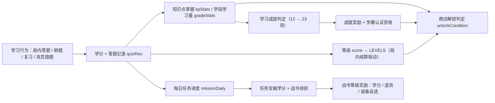

# 学分商店 · 学习激励设计方案

> 版本：v1.0（草案，待评审） ｜ 日期：2026-10-21 ｜ 状态：**设计稿，暂不改代码**
>
> 本文档是 v1.8.0 ~ v1.8.2「学分商店学习成果解锁」改版的**唯一设计依据**。
> 玩法速查见 [游戏机制.md](./游戏机制.md)，工程实现见 [架构设计.md](./架构设计.md)。
> 评审通过后再按 §8 分版本实现；实现前所有数值以本文档与实现时的代码为准。

---

## 1. 背景与问题

### 1.1 现状（已核对的代码事实）

**学分产出**（`src/profile/credits.ts`）：

| 行为 | 学分 | 说明 |
|---|---|---|
| 答题/刷题答对 | 3（初中）/ 4（高一高二）/ 5（高三） | `quizCreditFor(grade)` 按年级梯度 |
| 复习错题答对 | 2 | `ui/study.ts` |
| 攻克错题（我已复习） | 2 | `ui/study.ts` |
| 每日上限 | 300 | `addCredits` 触顶静默截断 |

**学分消耗**（`src/ui/shop.ts` + `scripts/build-expansion.mjs`）：

| 内容 | 现价 | 现条件 |
|---|---|---|
| 108 名扩展角色 | `CHAR_PRICE = 120 + 学期下标 × 40`（初一上 120 → 高三下 560） | 学分 |
| 18 件装备 | `EQUIP_PRICE = {1:80, 2:200, 3:400, 4:800}` | 学分 + 年级门槛（普通初一上 / 精良初三上 / 稀有高三上 / 史诗高三上·高三下） |
| 6 种道具 | `ITEM_PRICE = 50 ~ 100`（可重复购买） | 学分 |

### 1.2 核心问题

1. **年级是滑杆，不是学习成果**：用户把年级滑到「高三下」即可看到并购买全部高档内容，学习深度与解锁进度完全脱钩。
2. **学分只问量、不问质**：只刷一个学科的简单题也能攒够 800 学分买史诗装备。
3. **缺少日常目标与长线追求**：对标手游的「每日任务 / 战令 / 成就 / 里程碑」结构，本游戏目前只有一次性购买，学完即毕业，无回访钩子。
4. **道具只有购买一条路径**：学习行为不产生任何「掉落感」，正向反馈稀薄。

### 1.3 设计目标

> **让每一个解锁项都成为一次「学习邀请」**：用户为了解锁商店内容，而去答题、复习错题、掌握更多知识点、推进学段。

- 解锁条件从「学分 + 年级」升级为「**学分 + 学习成果**」多因子；
- 用确定性奖励结构（每日任务、学期战令、学习成就）替代手游的「充值/抽卡/保底」结构；
- 全程**零随机**：所有奖励为固定档位查表，无概率、无保底、无掉落。

---

## 2. 设计原则

| # | 原则 | 含义 |
|---|---|---|
| P1 | 零随机、全确定性 | 所有奖励按固定表发放；不看脸、可预期，适配教育场景 |
| P2 | 学习成果优先于在线时长 | 条件只由 `quizRec` 派生（答对/连对/掌握），不可用挂机或重复开关绕过 |
| P3 | 单一判定源 | 新增纯函数 `unlockCondition.ts`，UI 展示与购买扣费共用同一判定，杜绝双份规则 |
| P4 | 旧档兼容、不倒退 | 已解锁角色/装备保留；新字段按 `defaultProfile` 补齐，老用户零感知迁移 |
| P5 | 防刷守恒 | 每日上限 300 保留；任务宝箱独立计量（+100），防止刷任务绕开日限 |
| P6 | 懒加载不变量 | 任务/战令/成就 UI 只读内存中的 `quizRec` 派生数据，不触发任何题库分片加载 |
| P7 | 数值自洽 | 三张奖励表交叉核对（见 §9），掌握度供给、学分收支、战令总额互相咬合 |

---

## 3. 机制总览：三条链路



### 3.1 链路说明

- **获取链（学习 → 学分）**：行为埋点不变（`quiz.ts` / `drill.ts` / `study.ts` 三处 `addCredits`），新增两处纯派生统计（`gradeStats` 学段答对数、`missionDaily` 当日任务计数）。
- **成长链（学习 → 掌握度 → 等级）**：知识点掌握沿用 `kpStats()`（连对 `MASTER_STREAK = 3` 即掌握）；等级（`score`/`LEVELS` 11 级）继续由局内结算驱动，与学分双轨并行、互不兑换。
- **解锁链（掌握度 + 学分 → 商店内容）**：新增 `unlockCondition.ts` 统一判定；高档内容必须「有钱又有学问」。

### 3.2 术语表

| 术语 | 定义 | 数据来源 |
|---|---|---|
| 掌握（mastered） | 某题连对达 `MASTER_STREAK = 3` | `quizbook.ts` |
| 学科已掌握知识点数 | 该学科下 `mastered > 0` 的知识点个数 | `kpStats()` |
| 全库已掌握知识点数 | 九科合计已掌握知识点个数 | `kpStats()` / `masteredCount()` |
| 学段学习量 | 某学段（初中 = 初一上~初三下，高中 = 高一上~高三下）累计答对题数 | 新增 `PROFILE.gradeStats` |
| 学科精通 | 该学科已掌握知识点 ≥ 10 | `kpStats()` 派生 |
| 学霸认证 | 全库已掌握知识点 ≥ 60 且 学习类成就 ≥ 8 项 | `kpStats()` + `achievements` |

### 3.3 与现有体系的映射

| 本方案概念 | 落点 | 是否新增埋点 |
|---|---|---|
| 学分获取 / 每日上限 | `credits.ts` `addCredits` / `CREDIT_RULE` | 否（额度结构调整） |
| 学分来源统计 | `creditDaily` 增加 `sources` 分项 | 是（`addCredits` 同址记账） |
| 知识点掌握 | `quizbook.ts` `kpStats()` | 否（复用） |
| 学段学习量 | `PROFILE.gradeStats`（`recordAnswer` 答对时 +1） | 是（唯一新增学习统计） |
| 每日任务进度 | `PROFILE.missionDaily`（同日重置） | 是（与 `addCredits` 同址） |
| 战令 | `PROFILE.pass`（按学期隔离） | 是 |
| 解锁判定 | 新增 `src/profile/unlockCondition.ts`（纯函数） | 否 |
| 商店 UI | `ui/shop.ts` 卡片条件区块 + 新增「🎯 学习任务」页签 | 否 |

---

## 4. 确定性解锁数值表

> 所有价格沿用现值，不涨价；新增的只是「学习条件」。用户感知：**钱还是那些钱，但要先证明自己学过。**

### 4.1 角色解锁（108 名）

**学分价不变**：`120 + 学期下标 × 40`（初一上 120 / 初一下 160 / 初二上 200 / 初二下 240 / 初三上 280 / 初三下 320 / 高一上 360 / 高一下 400 / 高二上 440 / 高二下 480 / 高三上 520 / 高三下 560）。

**新增学科掌握门槛**（按学段分档，解锁该学期任一学科角色时要求**该学科**已达标，二选一）：

| 学段 | 学期下标 | 条件 A（掌握度） | 条件 B（做题量，替代路径） |
|---|---|---|---|
| 初中低段 | 初一上~初二下（0~3） | 该学科已掌握知识点 ≥ 2 | 该学科累计答对 ≥ 30 题 |
| 初中高段 | 初三上~初三下（4~5） | 该学科已掌握知识点 ≥ 5 | 该学科累计答对 ≥ 60 题 |
| 高中低段 | 高一上~高二下（6~9） | 该学科已掌握知识点 ≥ 8 | 该学科累计答对 ≥ 100 题 |
| 高中高段 | 高三上~高三下（10~11） | 该学科已掌握知识点 ≥ 12 | 该学科累计答对 ≥ 150 题 |

- 「该学科累计答对」= `PROFILE.subjects[学科]`（现有字段，答对时已累加）。
- 108 张角色卡共享上表 4 档规则，无需逐角色列举；实现时由 `charConditions(c)` 按 `c.grade` 查档位生成条件行。
- **设计意图**：解锁高三角色前，用户至少要在该学科认真掌握十几个知识点——把「年级滑杆」变成「学习证明」。

### 4.2 装备解锁（18 件）

| 档位 | 价格 | 年级门槛（保留） | 新增学习条件（需同时满足） |
|---|---|---|---|
| tier1 普通 ×4 | 80 | 初一上 | 无（新手引导，见 §4.4） |
| tier2 精良 ×4 | 200 | 初三上 | 初中学段答对 ≥ 60 题（`gradeStats` 初一上~初三下之和） |
| tier3 稀有 ×4 | 400 | 高三上 | 高中答对 ≥ 120 题 **且** ≥ 3 个学科达到「学科精通」 |
| tier4 史诗 ×6 | 800 | 高三上/高三下 | **学霸认证**：全库已掌握知识点 ≥ 60 **且** 学习类成就 ≥ 8 项 |

- 18 件装备逐件清单（id / 名称 / 档位 / 槽位 / 年级）以 `scripts/build-expansion.mjs` 的 `EQUIPS` 为准，本文不复制，避免双份事实。
- 高门槛装备在卡片上展示**分段进度**（如「高中答对 87/120」「学科精通 2/3」），点击条件行可跳转题库/刷题。

### 4.3 道具获取（6 种）

| 道具 | 学分价（不变） | 携带上限（不变） | 新增确定性来源 |
|---|---|---|---|
| 温故符 / 护身符 / 灵感符 / 锦囊符 / 拆弹符 / 铁壁符 | 50 ~ 100 | 2 ~ 3 | 每日任务宝箱、战令等级奖励（§4.5 / §4.6） |

- 道具不设学习门槛（消耗品，是学习行为的「产出」而非「目标」）；局末清空、不进牌堆的规则不变。
- `maxCarry` 与「购买即持有」语义不变；任务/战令发放走 `addItem()`，超上限部分按现有规则截断。

### 4.4 新手学习礼包（一次性、确定性）

| 时机 | 奖励 | 防重 |
|---|---|---|
| 首次打开学分商店 | tier1 装备自选 1 件（木剑 / 布甲 / 黄骠马 / 青骢马） | `PROFILE.newbieGift = true` |
| 完成首个每日任务 | 提示「学分已到账」+ 战令经验 +10 | 随任务进度自然发放 |

### 4.5 每日学习任务表（4 项，每日 0 点重置）

| 任务 | 目标 | 学分奖励 | 战令经验 | 计数埋点 |
|---|---|---|---|---|
| 日课·答对 | 当日答对 ≥ 10 题（局内/刷题合并） | 30 | +10 | `quiz.ts` / `drill.ts` 答对处 |
| 日课·复习 | 当日复习答对 ≥ 3 题 | 20 | +10 | `study.ts` 复习处 |
| 日课·攻坚 | 当日攻克错题 ≥ 2 题 | 25 | +10 | `study.ts` `markStudyReviewed` |
| 日课·连对 | 当日任意场景连对/连击 ≥ 5 | 25 | +10 | 连击增长处取当日最大值 |

- 任务奖励**独立计量**：日上限结构由 300 调整为「答题类 300 + 任务宝箱 100」= 每日最多 400，任务挤占不超过 1/4，答题激励仍是主轴。
- 连对任务语义与刷题 combo 一致：答错清零、取当日最大值；局内连击（`maxCombo`）同样计入。
- 任务进度存 `PROFILE.missionDaily = { date, quiz, review, wrongFixed, bestCombo, claimed: [] }`，跨日自动重置（复用 `creditDaily` 的日期判定模式）。

### 4.6 学期通关战令（等级 1 ~ 30）

- **战令周期 = 当前学期**（以 `SELECTED_GRADE` / `G.grade` 为准），切换学期重置等级与经验，历史学期记录只留展示。
- **经验来源**：答对 1 题 +2、复习答对 1 题 +5、攻克错题 1 题 +8、完成 1 个每日任务 +10。
- **升级曲线**：升到 Lv.L 所需经验 `= 100 + 30 × (L−1)`，升满 30 级共需 **16,050 经验**；按日均约 130 经验估算约 **124 天**，与一个学期的学习节奏匹配（「学期通关」由此得名）。
- **奖励全部固定查表**，等级即领、不重复领取（`PROFILE.pass.claimed`）：

| 等级 | 奖励 | 等级 | 奖励 |
|---|---|---|---|
| 1 | 学分 20 | 16 | 拆弹符 ×1 |
| 2 | 温故符 ×1 | 17 | 学分 65 |
| 3 | 学分 25 | 18 | 灵感符 ×1 |
| 4 | 护身符 ×1 | 19 | 学分 70 |
| 5 | 学分 30 | 20 | 🎁 tier2 装备自选 1 件 + 学分 80 |
| 6 | 灵感符 ×1 | 21 | 学分 75 |
| 7 | 学分 35 | 22 | 锦囊符 ×1 |
| 8 | 锦囊符 ×1 | 23 | 学分 80 |
| 9 | 学分 40 | 24 | 铁壁符 ×1 |
| 10 | 🎁 tier1 装备自选 1 件 + 学分 50 | 25 | 学分 90 |
| 11 | 学分 45 | 26 | 温故符 ×2 |
| 12 | 温故符 ×1 | 27 | 学分 95 |
| 13 | 学分 50 | 28 | 拆弹符 ×1 |
| 14 | 护身符 ×1 | 29 | 学分 100 |
| 15 | 学分 60 | 30 | 🎁 tier3 装备自选 1 件 + 学分 300 |

- **战令学分合计 1,310**（约为日上限 400 的 3.3 天量），核心价值在 3 件装备自选——满级一学期恰好「免费拿一套稀有配装」。
- 装备自选发放走「直接解锁」通道（写入 `unlockedEquips`，不经扣费），复用现有 `buyEquip` 的解锁写入路径拆分出的 `grantEquip(id)`。

### 4.7 学习成就扩展（12 → 23 项）

现有 12 项不变；新增 11 项（全部确定性判定，解锁时发 **学分 50 + 积分 30**）：

| id | 名称 | 条件 | 判定来源 |
|---|---|---|---|
| `quiz_100` | 百题斩 | 累计答对 100 题 | `PROFILE.correctQuiz` |
| `quiz_300` | 题海无涯 | 累计答对 300 题 | `PROFILE.correctQuiz` |
| `kp_20` | 初窥门径 | 全库已掌握知识点 ≥ 20 | `kpStats()` |
| `kp_60` | 博闻强识 | 全库已掌握知识点 ≥ 60 | `kpStats()` |
| `streak_10` | 十连绝世 | 单次连对/连击 ≥ 10 | 刷题 combo / 局内 `maxCombo` |
| `daily_7` | 七日不辍 | 连续 7 天完成 ≥ 1 个每日任务 | `missionDaily` + `PROFILE.studyStreak` |
| `subject_master` | 学科精通 | 任一学科已掌握知识点 ≥ 10 | `kpStats()` |
| `all_master_9` | 九科学霸 | 9 个学科均达到学科精通 | `kpStats()` |
| `perfect_game` | 全对达人 | 单局答题全对且题数 ≥ 5 | `quizStats`（`maybeSettle`） |
| `pass_30` | 学期圆满 | 战令达到 30 级 | `PROFILE.pass` |
| `first_unlock` | 学有所用 | 首次在商店解锁任意角色/装备 | `unlockChar` / `grantEquip` 首次成功 |

- 学习类成就同时是 **tier4 装备「学霸认证」的计数口径**（≥ 8 项），与 §4.2 咬合。
- `daily_7` 需要新增 `PROFILE.studyStreak = { lastDate, days }`，在每日任务完成时更新（断日清零）。

---

## 5. 解锁判定：纯函数设计（实现阶段落地）

```ts
// src/profile/unlockCondition.ts（新增，无 IO、可单测）
export interface UnlockCond {
  key: string;        // 条件标识，如 'kp_math'
  label: string;      // 展示文案，如「数学·已掌握知识点」
  cur: number;        // 当前进度
  need: number;       // 需求
  ok: boolean;        // 是否达标
  jump?: 'bank'; // 未达标时的引导跳转目标（题库页内含刷题入口）
}
export function charConditions(c: Character): UnlockCond[];   // 学分 + 学科掌握（A/B 二选一 OR 组）
export function equipConditions(e: EquipDef): UnlockCond[];   // 学分 + 学段里程碑（AND 组）
export function condAllOk(conds: UnlockCond[]): boolean;
```

- 输入仅 `PROFILE` + `kpStats()` 派生值；`kpStats()` 遍历内存中的 `quizRec`，不加载题库分片（P6）。
- **UI 与购买共用**：`shop.ts` 卡片渲染条件区块；`credits.ts` 的 `unlockChar` / `buyEquip` 在扣费前先跑同一判定，不满足直接 `return false`，杜绝「界面显示可买、点击失败」。
- OR 组（角色学科门槛 A/B）在 UI 上展示为「条件 A 或 条件 B 任一满足」。

---

## 6. 商店 UI 改版

### 6.1 结构变化

```
#shopModal
├─ 学分概览（shop-credit）
│   ├─ 学分余额 / 今日获取进度（答题 300 + 任务 100）
│   └─ 🆕 今日来源分布：答题 x / 复习 x / 任务 x / 战令 x
├─ 学期筛选（shop-grades）
├─ 页签：角色 ｜ 装备 ｜ 道具 ｜ 🎯 学习任务
├─ 内容区
│   ├─ 角色/装备/道具卡（shop-card）
│   │   ├─ 🆕 解锁条件区块：每条件一行「图标 + 文案 + cur/need + ✓/✗」
│   │   └─ 🆕 未达标条件行内「去刷题 →」跳转按钮
└─ 🆕 学习任务页：每日任务卡（进度 + 领取）+ 战令进度条 + 奖励表（折叠）
```

### 6.2 关键交互

| 场景 | 行为 |
|---|---|
| 条件未达标 | 卡片置灰但**可点击查看条件**（现有「🔒 需达到 X」升级为条件清单） |
| 点击学科掌握类条件 | 跳转题库浏览页对应学科（`openBankBrowser`）或刷题面板 |
| 学分够但学习条件不够 | 购买按钮 disabled，tooltip 显示首个未达标条件 |
| 顶栏 🪙 入口 | 有可领任务/战令奖励时显示红点（复用 `credits-updated` 事件通道） |
| 新手首次进店 | 弹一次 tier1 自选礼包（`PROFILE.newbieGift`） |

### 6.3 样式

- 新增 `.sc-conds` / `.sc-cond` / `.sc-cond-ok` / `.sc-cond-jump` / `.sc-missions` / `.sc-pass` 等类，沿用现有 shop 设计语言（`style.css` 第 904 行起的「学分商店弹窗」区块后追加）。

---

## 7. 兼容性、防刷与公平性

### 7.1 存档兼容（`xuetangsha_profile_v1`）

- 新增字段全部走 `loadProfile()` 的 `Object.assign(defaultProfile(), p, {...})` 兼容模式：`gradeStats`、`missionDaily`、`creditDaily.sources`、`pass`、`studyStreak`、`newbieGift`，以及 11 个新成就 id。
- **迁移规则**：老用户 `unlockedChars` / `unlockedEquips` 已购内容**保留且视为已满足新条件**（不回收、不补收）；`creditDaily.sources` 缺失时回退为仅展示总额。
- 联机不同步学分/战令（`PublicProfile` 不扩展），保持现有协议不变。

### 7.2 防刷

| 风险 | 对策 |
|---|---|
| 刷任务绕开日限 | 任务宝箱独立额度 100/日，总额 400 封顶 |
| 重复开关界面刷计数 | 任务计数只在真实学习事件埋点处 +1（答对/复习/攻克/连击） |
| 小号刷连对 | 连对取当日最大值，答错清零，无法累计 |
| 换年级刷学段量 | `gradeStats` 按学期真实累加，与当前选中年级无关 |
| 挂机 | 无任何在线时长奖励，全部条件要求实际作答 |

### 7.3 公平性与可达性估算（中位学习强度）

| 内容 | 学习条件 | 估算达成天数 |
|---|---|---|
| tier1 装备 | 无（新手礼直接送） | 0 |
| tier2 装备 | 初中学对 60 题 | 3 ~ 6 天 |
| tier3 装备 | 高中答对 120 + 3 科学精通 | 30 ~ 60 天 |
| tier4 装备 | 掌握 60 知识点 + 8 项学习成就 | 60 ~ 120 天 |
| 高三下角色 | 该学科掌握 12 知识点 | 20 ~ 40 天 |
| 战令满级 | 16,050 经验 | 约 124 天（≈ 一学期） |

- 所有条件均可在游戏内行为达成，**无付费、无随机、无时限门槛**；高档内容「贵且慢」，但路径全程可见。

---

## 8. 分版本实施路线

| 版本 | 范围 | 交付物 |
|---|---|---|
| **v1.8.0** | 解锁条件 + 商店 UI | `unlockCondition.ts`；`shop.ts` 条件区块与跳转；`gradeStats` 埋点与存档兼容；新手礼包；smoke 新增「条件拦截」用例 |
| **v1.8.1** | 每日任务 + 学分来源 | `missionDaily` 埋点与跨日重置；「🎯 学习任务」页签；`creditDaily.sources`；顶栏红点；smoke 新增「任务领取/重置」用例 |
| **v1.8.2** | 战令 + 成就扩展 + 收尾 | `PROFILE.pass` 与 30 级奖励表；11 个新成就与发奖；`grantEquip` 直通解锁；数值平衡回归；同步 `docs/游戏机制.md` 与 CHANGELOG |

每版发布前门禁（沿用现有流程）：`typecheck` → `audit:expansion` → `build`（CDN + bundled）→ `verify:dist` → `smoke` → `smoke:net` → `smoke:net:settle` → `smoke:tiesuo` → `audit:banks`，全绿后按发布流程提交。

---

## 9. 数值自洽核对

| 核对项 | 结论 |
|---|---|
| 掌握度供给 | 全库 1,090 个讲解 ≈ 每学科 121 个（1090 ÷ 9）；「学科掌握 12」约占单学科 10%，「全库 60」≈ 九科人均 6.7 个，均可达且需真实学习 |
| 学分收支 | tier4 800 学分 ≈ 2 天满额；叠加学霸认证后纯攒学分不再足够，「钱」与「学问」双约束生效 |
| 战令总额 | 1,310 学分 + 3 件装备自选 ≈ 一学期学习回报；经验 16,050 ≈ 日均 130 × 124 天，与学期长度匹配 |
| 任务占比 | 任务日奖励 100 / 日上限 400 = 25%，答题仍是学分主轴，任务只作日常钩子 |
| 成就发奖 | 11 项 × 50 学分一次性 ≈ 550 学分，约为一件 tier3，不破坏经济 |

---

## 10. 验收清单（实现阶段逐项勾选）

- [ ] 学科掌握度不达标时无法解锁角色（按钮 disabled + 条件清单 + 首个未达标条件提示）
- [ ] 商店卡片进度数值与 `kpStats()` / `subjects` / `gradeStats` 完全一致（同一判定源）
- [ ] 旧档（无任何新字段）登录不白屏，已解锁角色/装备全部保留
- [ ] 每日任务跨日重置、四类计数与埋点行为一一对应
- [ ] 任务宝箱独立额度生效，日总额不超过 400
- [ ] 战令切换学期重置；等级奖励可领且不重复；30 级装备自选走 `grantEquip`
- [ ] 11 个新成就解锁时正确发放学分 50 + 积分 30
- [ ] 懒加载不变量：任务/战令页签不触发任何题库分片请求（dev 模式 Network 面板验证）
- [ ] 全部门禁通过（typecheck / 双模式 build / verify:dist / smoke 新增用例 / smoke:net / audit:*）

---

## 附录 A：现有数值基线（实现前快照）

| 项 | 值 | 位置 |
|---|---|---|
| `CREDIT_RULE` | 答对 3 / 复习 2 / 攻克 2 / 日上限 300 | `src/profile/credits.ts` |
| `quizCreditFor` | 3 + floor(学期下标 / 6)（3~5） | 同上 |
| `CHAR_PRICE` | 120 + 学期下标 × 40 | `scripts/build-expansion.mjs` |
| `EQUIP_PRICE` | 80 / 200 / 400 / 800 | 同上 |
| `ITEM_PRICE` | 50 ~ 100 | `src/ui/shop.ts` |
| `MASTER_STREAK` | 3 | `src/profile/quizbook.ts` |
| `LEVELS` | 11 级（0 → 7500 分） | `src/profile/profile.ts` |
| `ACHIEVEMENTS` | 12 项 | 同上 |
| 题库规模 | 12 学期 × 9 学科，9,149 题 / 1,090 讲解 / 918 关系 | `data/banks/` |
| 配装限额 | 装备 2 件 / 道具 3 个 | `credits.ts` |
