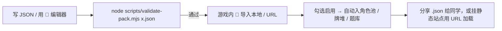

# 自定义扩展包规范（xts-pack v1）

学堂杀支持玩家自制扩展包：角色、锦囊、题目三部分可任意组合，导入即生效，**无需改动引擎、无需重新构建**。

> **适用范围**：自定义扩展包「仅单机 / 房主」可用。联机加入方由房主统一携带，自己无需安装（也看不到自定义内容）。

---

## 一、文件结构

一个扩展包就是一个 JSON 文件，根字段如下：

| 字段 | 类型 | 必填 | 说明 |
|---|---|---|---|
| `format` | `"xts-pack"` | ✅ | 固定标识 |
| `version` | `number` | ✅ | 当前为 `1` |
| `id` | `string` | ✅ | 包唯一标识，建议 `custom_` 前缀 |
| `name` | `string` | ✅ | 展示名 |
| `author` | `string` | | 作者署名 |
| `desc` | `string` | | 简介 |
| `characters` | `PackCharacter[]` | 至少 1 项 | 角色定义 |
| `cards` | `PackCard[]` | 至少 1 项 | 锦囊牌定义 |
| `questions` | `{ 年级: Question[] }` | 至少 1 项 | 题目，按年级归组 |

只要 `characters` / `cards` / `questions` 中至少含一项即可。

---

## 二、角色 `characters[]`

```jsonc
{
  "id": "custom_runner",          // 必填，建议 custom_ 前缀，不得与内置 81+108 名重名
  "name": "飞人",                  // 必填
  "title": "短跑健将",             // 必填
  "faction": "physics",           // 必填：九科 id（见下）
  "subject": "物理",               // 与 faction 对应的中文名
  "hp": 4,                         // 必填：2~5
  "avatar": "🏃",                  // 必填：单个 emoji
  "grade": "初二上",               // 必填：12 个内置学期之一
  "skills": [ /* 见下方技能 */ ]
}
```

**九科 `faction`**：`chinese` `math` `english` `physics` `chemistry` `biology` `history` `geography` `politics`。

### 技能 `skills[]`

每条技能即一条「声明式技能定义」，由引擎用**全套 `SkillE` 原语**执行（与内置 81 名角色同源）：

```jsonc
{
  "id": "custom_runner_sk",   // 必填，建议 <角色id>_sk
  "name": "冲刺",
  "kind": "active",           // active/trigger/passive/limit/awaken/lord/convert
  "timing": "active",         // 见「时机」表
  "desc": "弃 1 张手牌，摸 2 张牌",
  "effects": [ { "kind": "costCard", "n": 1 }, { "kind": "selfDraw", "n": 2 } ]
}
```

可选字段：`cost`（发动费用）、`limit`（perTurn/perGame）、`cond`（触发条件）。

**时机 `timing`**：`active` `passive` `onTurnStart` `onDraw` `onTurnEnd` `beforeJudge` `beforeDamage` `onDamaged` `onTargetSha` `onUseShan` `onShaHit` `onUseTrick`。

**可用原语 `effects[].kind`**（常用，全集见 `src/core/types.ts` 的 `SkillEffect`）：

- 资源：`selfDraw` `selfHeal` `selfLoseHp` `shield` `gainKnowledge` `spendKnowledge`
- 单体：`targetDraw` `targetHeal` `targetDamage`(带 `damageType`) `targetLoseHp` `targetDiscard` `gainHand`
- 群体：`allDraw` `allHeal` `allDiscard`
- 费用：`costCard`(带 `n`，可选 `require:'sameNum'|'sameSuit'`)
- 牌堆操控：`star` `starSort` `deckPeek` `deckBottom` `toDeckTop` `discardToTop` `peekTopDeck`
- 转化：`convert`(把满足条件的手牌当 `sha`/`shan`/`tao`/`jiu`/`guohe`)
- 点数/博弈：`judgeIf` `chainJudge` `guessSuit` `pointDuel` `doubleJudge` `costThenDamage`
- 距离/交互：`distMod`(delta) `rangePlus` `distPlusToMe` `immune`(scope) `cardImmune`(names) `distTrap` `trickRedirect` `shaRedirect`
- 状态：`addMark` `tickMark` `awaken` `revive` `handLimit` `extraDraw`

> **规则**：主动技（`kind:active`）发动前必须先答对一道题（知识考核门槛），且每回合限一次；因此设计强度时按 ~70% 命中率折算。`costCard` 等费用不足时技能不发动、也不消耗次数。

---

## 三、锦囊 `cards[]`

锦囊走「知识点锦囊」数据驱动通道，可用**全套 `SkillE` 原语**：

```jsonc
{
  "key": "custom_relay",       // 必填，建议 custom_ 前缀，成为卡牌 sub
  "name": "接力赛",
  "subject": "campus",         // 九科 id 或 campus（中性配色）
  "kind": "strategy",          // strategy=出牌即生效；quiz=先答题，答对才生效
  "target": "none",            // none=无需目标；one=需指定一名其他角色
  "deck": 2,                   // 牌堆投放张数，建议 1~3
  "desc": "观看牌堆顶 2 张，取 1 张入手",
  "effects": [ { "kind": "deckPeek", "n": 2, "then": "pickOne" } ],
  "quizSubject": "物理",        // 仅 quiz 型：优先抽题学科
  "onWrong": [ /* 答错反噬效果，省略则哑火 */ ]
}
```

`effects` 与角色技能使用同一套 `SkillE` 原语（见上）。

---

## 四、题目 `questions`

与既有题库格式一致，按年级归组：

```json
{
  "初二上": [
    { "s": "物理", "kp": "运动学", "q": "哪个是矢量？", "o": ["质量","位移","时间","路程"], "a": 1 }
  ]
}
```

`a` 为从 0 起的下标且 `< o.length`。导入后并入 `QUESTION_BANK`，按年级懒加载。

---

## 五、制作与分发流程



1. **手写 JSON**：照本文档拼接，或以「🧩 编辑器」表单快捷添加角色/锦囊/题目，导出 JSON。
2. **离线校验**：`node scripts/validate-pack.mjs your.pack.json`，含 PP 战力预算告警。
3. **导入启用**：首页顶栏 🧩 → 导入本地文件 / 从 URL 加载；勾选「启用」。
4. **联机**：仅房主安装即可；加入方随房间自动接收角色与题目（无需安装）。

---

## 六、作者自检清单

- [ ] `id` / `key` 带 `custom_` 前缀，不与内置重名（否则导入被拒）
- [ ] `faction` 是九科 id，不是中文名（中文名填 `subject`）
- [ ] `grade` 用 12 个内置学期之一
- [ ] 每题 `a` 为 0 起下标且 `< o.length`
- [ ] 主动技 `effects` 第一个是 `costCard`（避免白嫖）
- [ ] `target:"one"` 的卡其 `effects` 含真正用到目标的效果
- [ ] `deck` 不超过 3（避免稀释基础牌手感）
- [ ] 角色 PP 预算 ≤ 5（`validate-pack.mjs` 会告警）

---

## 七、实现说明（开发者）

- `src/data/packRegistry.ts`：运行时注册表 + 校验（含 PP 预算警告）+ 安装/卸载/启用 + localStorage 持久化。纯数据、无顶层副作用、不依赖 UI 模块。
- 角色：每条技能经 `registerSkillDef` 注入 `SKILL_DEFS` 的运行时表，由 `src/game/skillEngine.ts` 用 `SkillE` 原语结算。
- 锦囊：每条卡牌经 `registerTrick` 注入 `KNOWLEDGE_TRICKS` 的运行时表，由 `cards.ts` 自动入牌堆、`actions.ts` 通用结算。
- 题目：走既有 `mergeBankData` 合并通道。
- 联机：房主权威，客户端仅渲染与应答；自定义内容随 `Player.character` 与 `ask_quiz_request` 下发，加入方无需安装。
